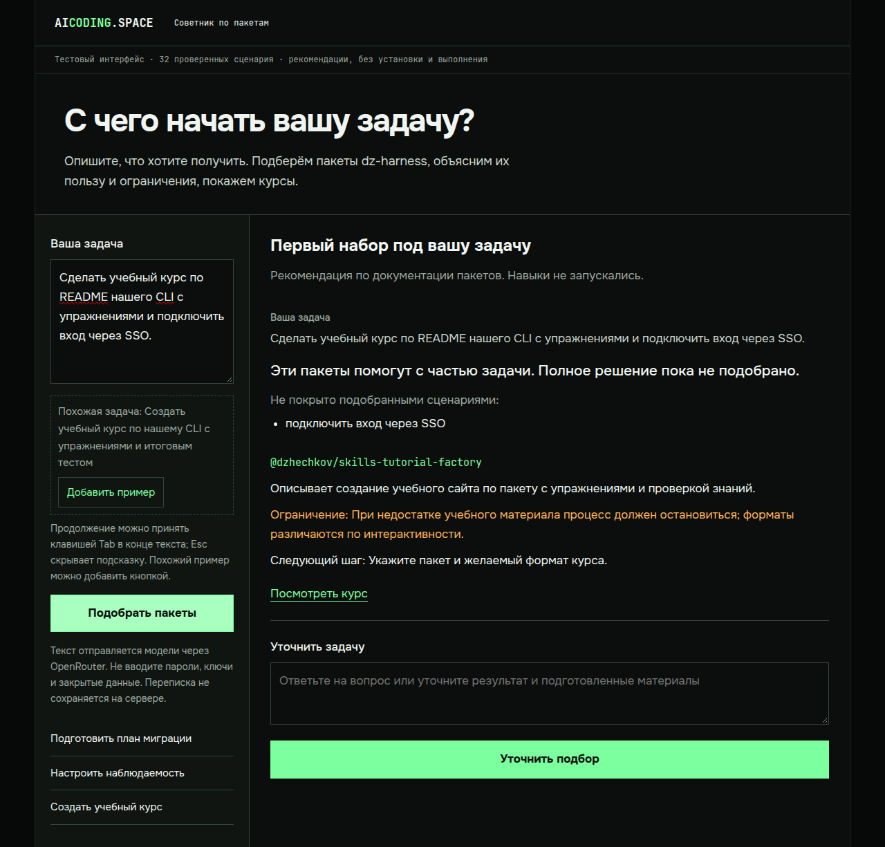
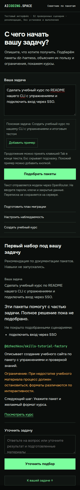

# Советник: тестовый интерфейс после доработки диалога

Свободный вопрос, примеры задач, Tab-autocomplete и кнопка на телефоне. Успешные уточнения накапливаются, последнее уточнение может исправлять предыдущее. Ошибка сохраняет введённый текст и историю; новая задача начинает новый диалог.

Снимки показывают один реальный браузерный запрос через модель. Ответ [сохранён здесь](live-answer.json): сценарий курса подходит для создания учебного материала, SSO явно отмечен как непокрытая часть. Навыки не запускались.

Отдельные браузерные проверки использовали подставные ответы: ошибки, три последовательных уточнения, новая задача, буквальный вывод HTML, Tab/Esc, изменение позиции курсора и мобильное касание. Реальная клавиатура IME не проверялась — только синтетические события.

Приватный запуск через SSH пока доступен по [прежней инструкции](../preview/README.md). Кандидат HTTPS-доступа без SSH подготовлен и проверен локально, но не развёрнут: [документы и конфигурация](../../../../features/advisor-preview-readiness/access-candidate/README.md). Публичной страницы ещё нет. После проверок тестовый сервер остановлен.
