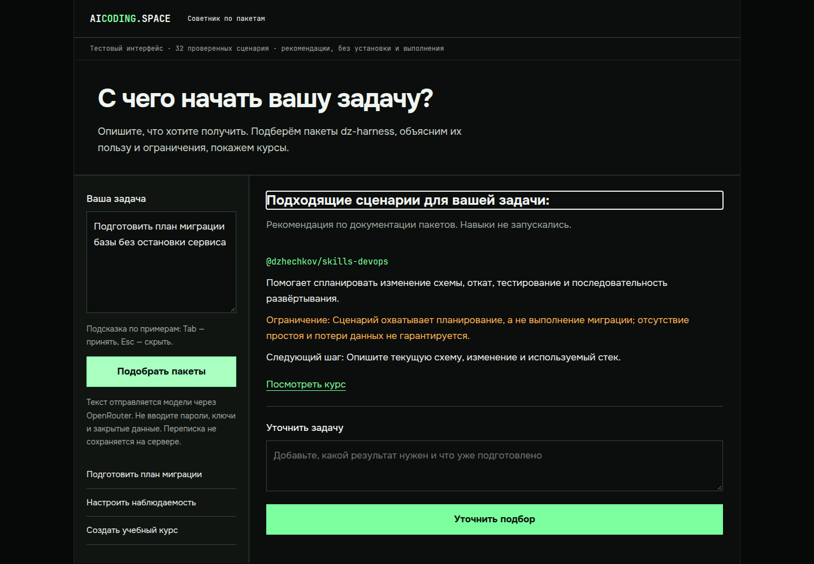
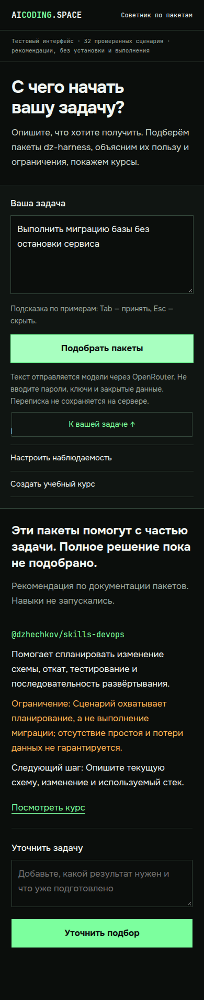

# Рабочий тестовый интерфейс советника

Свободный текст — основной ввод. Примеры заполняют поле, но не отправляют запрос. После3 символов совпавшего начала появляется локальное продолжение из восьми примеров: Tab принимает, Esc скрывает, на телефоне есть кнопка. Это autocomplete по примерам, не генерация моделью на каждое нажатие. Без подсказки Tab переводит фокус обычно; Shift+Tab не перехватывается.

После ответа можно добавить свободное уточнение. В модель уходит исходная задача вместе с накопленными уточнениями (до6000 символов). Это повторный подбор с контекстом задачи, не автономный агент с выполнением команд. Пакеты, ограничения и ссылки возвращает проверенный backend из PR30.

## Компьютер



## Телефон



## Запуск и просмотр

Это приватный loopback preview, не опубликованная страница сайта. Для подключения с собственного компьютера используйте SSH-туннель к VPS (замените имя SSH-хоста своим):

```sh
ssh -L 8893:127.0.0.1:8893 YOUR_VPS
```

В открывшемся терминале VPS:

```sh
cd /var/lib/aicoding/dz-harness-opencode-20261109
python3 integrations/skill-advisor-catalog/start-preview.py
```

Затем откройте **http://127.0.0.1:8893/** в браузере своего компьютера. Не localhost: проверяется точный Host/Origin. Ctrl+C останавливает сервер. Ключ берётся из существующего защищённого серверного файла либо OPENROUTER_API_KEY; браузер его не получает. На другом сервере нужны checkout и переменная окружения; локальные шрифты опционально задаются через ADVISOR_FONTS_DIR.

Лимит тестовой сессии30 запросов, одновременно1 вызов. Публичного endpoint и постоянного сервиса нет. Сервер после нашей проверки остановлен; запуск выше создаёт новую сессию. Поля не сохраняются приложением, но отправляются внешнему провайдеру; не вводите секреты. Курсы открываются внешними ссылками.

## Проверка

67 тестов прошли, включая свободный русский текст, разрыв UTF-8 между сетевыми частями, Host/Origin, лимит, whitelist файлов, обработку провайдерной ошибки. Chromium1440/390: Tab-autocomplete, переход фокуса после принятия, отсутствие переполнения/JS ошибок; реальный запрос на компьютере, контролируемый partial ответ на телефоне. Ошибка уточнения сохраняет предыдущий ответ и доступную форму для повторения. [Отчёт браузера](browser-check.json).

Сохранены цвета, шрифты и расположение исходного мокапа aicoding.space. Impeccable обнаружил возможное тесное размещение chooser; padding контейнера проверен, наследуемые отрицательные отступы списка убраны. При первом проходе выявлено отсутствие второго блока исходных CSS; перенесены оба блока и повторно проверено оформление. Публичный сайт и его рабочие файлы не изменялись.
