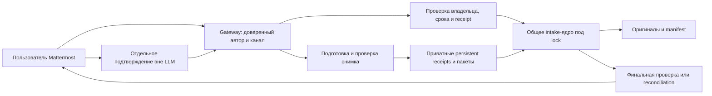
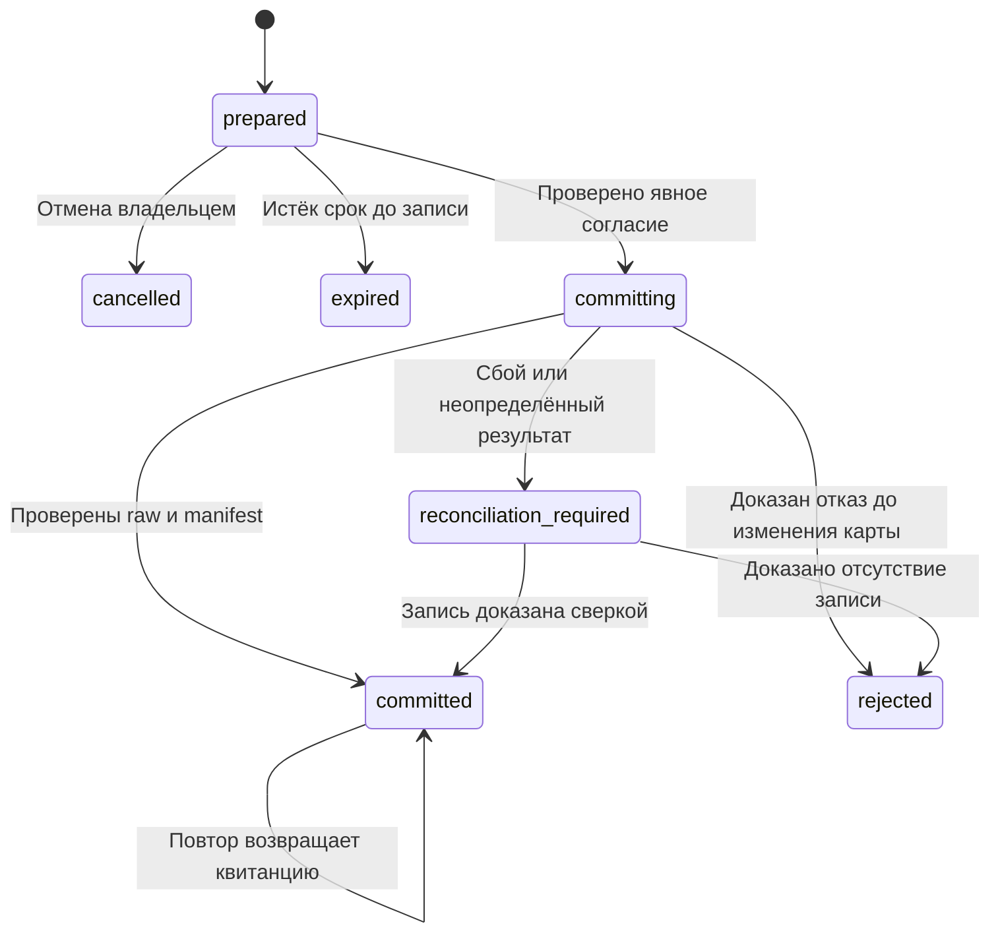
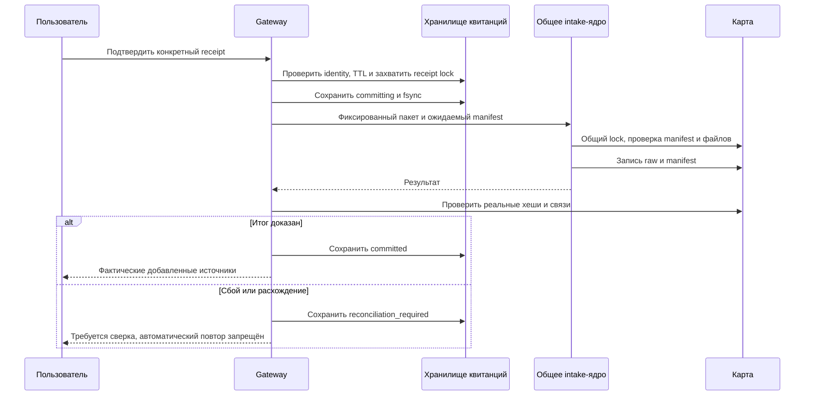

# HLD/LLD подтверждаемой записи

## Компоненты

## Подготовка

Предлагаемый инструмент health_intake_prepare (пока не существует) использует проверенный inbox, сохраняет копию исходника и детерминированный пакет в приватной директории состояния вне карты. Перед выдачей квитанции выполняет полноценный preview и проверку текущих источников. Задаётся TTL 30 минут, лимиты preview0.2 и квота prepared-пакетов на профиль; квоту проверить до записи. Удалять только expired/cancelled пакеты после регистрации очистки; unknown/committing не очищать по TTL.

Квитанция: schema, receipt_id (128+ случайных бит), runtime/plugin version, platform/profile/user_id/chat_id, source_message_id при доступности, workspace identity, created_at/expires_at, state, original_name (не authority), attachment_sha256/bytes, archive_sha256/bytes, manifest_sha256, sorted files[path,sha256,bytes], result. Не включать токены Mattermost. Пакеты 0600, каталог 0700, no symlink, atomic rename + fsync файла и родительского каталога. State store — не общий tmp и не публичный Git.

## Подтверждение

Модель показывает количество новых файлов, дубли/конфликты, receipt и срок. Пользователь подтверждает конкретный receipt через транспорт, который перехватывается до LLM. Кандидат — register_command Hermes; требуется проверить доставку Mattermost slash. Если Mattermost её не передаёт, отдельная текстовая команда адаптера или action endpoint с аутентификацией, а не просьба модели распознать «да».

Gateway должен связать identity в ContextVar. get_session_env умеет fallback в os.environ — отсутствие реально связанного контекста должно давать отказ. Прямой CLI/cron без доверенного gateway-контекста не подтверждает пользовательский receipt.

## Состояния

Неизвестное состояние не переводить в prepared автоматически. Повтор committed проверяет действующие хеши; последующее повреждение возвращается как drift, а не новый intake.

## Порядок записи

Перед записью нужен действующий backup; это условие эксплуатации, а не замена transaction journal. После записи отдельно проверять backup offsite. Push сохраняет только Git-tracked часть и не заменяет backup оригиналов.
