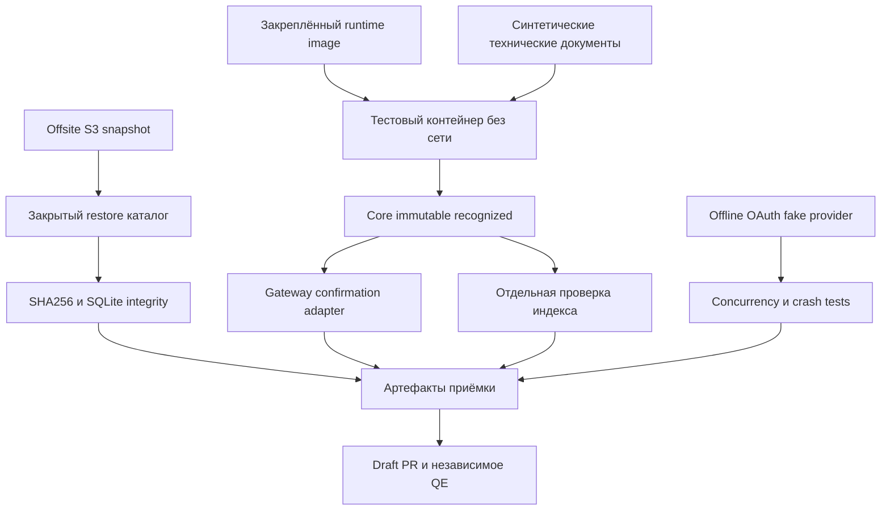

# Архитектура проверки

Стрелки — зависимости проверки, не сетевые подключения. Restore с реальными
данными никогда не монтируется в экспериментальный контейнер. Рабочие сервисы
остаются на прежней версии. Ночная ветка наследует открытый PDF draft PR;
готовность отдельного среза не разрешает автоматически merge всей цепочки.

Исполняемый OAuth ADR находится в соседнем feature hermes-oauth-offline-lab.
Recognized core находится в отдельном worktree dz-harness-health-recognized;
его уточнённый контракт имеет приоритет над первоначальным parent proposal.
Gateway и index acceptance имеют отдельные проверяемые границы. Никакого
автоматического перехода saved → clinically verified → indexed нет.
